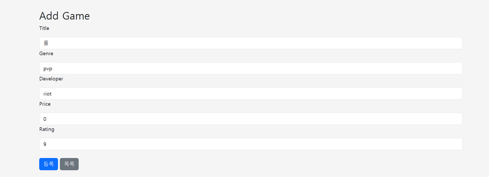
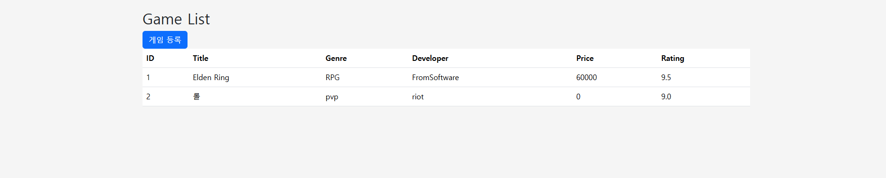

# Week06 Game CRUD Web UI

Spring Boot와 Thymeleaf를 이용해서 Game CRUD Web UI를 만들었다.

지난주에 만든 REST API 구조를 사용하고 게임 목록과 등록 화면을 추가했다.

## Deploy

Render URL
https://assign06-c01-22400401.onrender.com/games

## Project Structure

src/main
-> java
-> org.example.week06_javacrud1
-> controller
-> GameController.java
-> GameWebController.java

-> domain
-> Game.java

-> dto
-> GameRequest.java
-> GameResponse.java

-> repository
-> GameRepository.java
-> MemoryGameRepository.java

-> service
-> GameService.java

-> Week06Javacrud1Application.java

src/main
-> resources
-> templates
-> games
-> list.html
-> form.html

-> static
-> css
-> style.css

→ application.properties

## Game

- id
- title
- genre
- developer
- price
- rating

## Web Endpoint

GET /games - 게임 목록 조회
GET /games/new - 게임 등록 화면
POST /games - 게임 등록
POST /api/games - 게임 등록
GET /api/games - 전체 조회
GET /api/games/{id} - 게임 조회
PUT /api/games/{id} - 게임 수정
DELETE /api/games/{id} - 게임 삭제
GET /api/games/genre/{genre} - 장르별 조회

## Run

게임 목록

http://localhost:8080/games

게임 등록

http://localhost:8080/games/new

## Screen

## Keywords

- Spring Boot
- Thymeleaf
- Web UI
- HTML Form
- Controller
- Model
- ModelAttribute
- Bootstrap

### Controller

REST API에서는 RestController를 사용했고 Web UI에서는 @Controller를 사용했다.

### Model

Controller의 데이터를 HTML로 전달하기 위해 Model을 사용했다.

### Thymeleaf

th:each와 th:text를 사용해서 게임 목록을 화면에 출력했다.

### HTML Form

Form에서 게임 정보를 입력하고 POST 방식으로 서버에 전달했다.

### Redirect

게임 등록 후 다시 게임 목록으로 이동하도록 만들었다.

### Key Learning

기존 REST API 구조에 Web UI를 추가하는 방법을 배웠다.
Service와 Repository는 그대로 사용하고 Web UI용 Controller와 HTML을 추가했다.

### Web UI Flow

Browser -> Controller -> Service -> Repository -> Memory ->
Model -> Thymeleaf -> HTML

### Form Flow

HTML Form → Controller → Service → Repository → Memory → Redirect → Game List

### Problem & Solution

처음 프로젝트를 만들 때 프로젝트 폴더와 Git 폴더가 겹쳐 Gradle이 제대로 인식되지 않았다.
끝까지 뭘 하고 내가 처음보는 명령어들을 입력해도 다 안됐다. 다시 만들었다. 

### Code Review

REST API용 GameController와 Web UI용 GameWebController를 따로 만들었다.
기존 Service와 Repository는 그대로 사용했다.

### AI Usage

오류가 났다. 4시간 가량 만든 파일을 전부 지워야했다. 지우기 싫어서 계속 어떤 오류인지 계속 찾았다.
코드를 짜는 건 문제가 되지 않았다. 실행이 안되고 테스트가 안됐다. 오류를 찾는데, 메시지를 쓰기 귀찮을 때
쓴 것 같다. 리드미를 만들 때도 도움을 받았다. 
### Reflection

지난주에는 Postman에서 JSON 데이터를 확인했지만 이번에는 브라우저에서 직접 게임을 등록하고 목록을 확인했다.
REST API와 Web UI의 차이를 이해하는 데 도움이 됐다.

### Suggestion

오류가 났다. 4시간 가량 만든 파일을 전부 지워야했다. 지우기 싫어서 계속 어떤 오류인지 계속 찾았다.
코드를 짜는 건 문제가 되지 않았다. 실행이 안되고 테스트가 안됐다. 다행히 연결과 커밋만 하고 푸쉬를 
안한 상태였고, 교수님이 꼬이면 다시 한다는 말이 생각나서 눈물을 머금고 다시 만들었다. 힘들었다. 
다시 만들고 복사 하는 과정에서 했던 커밋도 날아가서 횟수도 못채웠다.